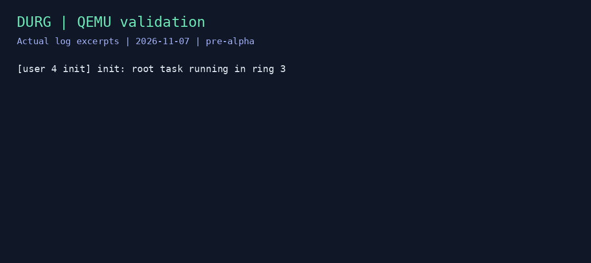

<div align="center">

# Durg (दुर्ग)

### A fortress for untrusted agents.

A pre-alpha Rust capability OS exploring isolated execution of untrusted AI-agent tools.

[](https://github.com/VenkateshPanda0/Durg/actions/workflows/ci.yml)


[](LICENSE)
[](https://github.com/VenkateshPanda0/Durg/issues)


[Why](#the-problem) · [The idea](#the-idea-five-promises) · [Demo goal](#the-demo-we-are-building-towards) · [Design](#how-it-works) · [Roadmap](#roadmap) · [**Contribute**](#-contribute) · [FAQ](#faq)

</div>



*Animated excerpts from an actual local validation run, not an interactive terminal recording.*

**Try it locally (Ubuntu/Debian or Ubuntu on WSL, from this checkout):**

```bash
bash scripts/setup.sh
```

This installs build dependencies and Rust if needed, then boots all six test variants.
After setup, `cargo xtask run` runs the local demo. There is no hosted live demo.
See the [changelog](CHANGELOG.md), [CI runs](https://github.com/VenkateshPanda0/Durg/actions/workflows/ci.yml)
and [contribution guide](CONTRIBUTING.md).

> **Honest status:** Durg is a **pre-alpha research kernel**. It boots under QEMU, manages memory, schedules isolated user programs, and exercises a partial capability system with message passing and a root task. M10 is in progress; drivers, persistent storage, provenance, session undo, approval and broker services remain planned. No security claim here is verified. Each promise below becomes a claim only once a test or a written argument in the threat model backs it. You are early, which means your feedback can still shape the foundations.

---

## The problem

AI agents now run commands on real machines, and the failures are public: deleted home directories, leaked tokens, prompt injection in the wild.

A recurring pattern is the **trust handoff**. The agent stays inside its sandbox, but writes a file (a git hook, an editor task, an interpreter config) that a more trusted, unsandboxed tool later executes. The sandbox held, and the system was still compromised.

That is an **ambient authority + missing provenance** problem. Typical sandboxes run a full Linux guest, so the agent still sits in a large environment where it can name almost everything, and nothing tracks where a file came from or lets you undo a session. Capability systems were built for this, and Durg applies that model to the agent use case.

## The idea: five promises

Each one is designed to become a **testable property**, not a slogan.

| # | Promise | In plain words |
|---|---|---|
| 1 | **No ambient authority** | A process can only act on objects it holds a capability for. No global paths, no root user, no inherited permissions. |
| 2 | **Provenance labels** | Everything an agent session creates is tagged with that session. Trusted code can't consume it without an explicit, journaled acceptance. |
| 3 | **Effect journal + session undo** | Side effects go into a hash-chained log on copy-on-write storage, so a whole session can be rolled back. |
| 4 | **Approval as a capability** | Destructive or external actions need a one-time capability that only the human console can mint. No prompt or agent can create one. |
| 5 | **Brokered egress and secrets** | No raw network. Traffic goes through a host-side broker over vsock that applies policy and injects credentials, so the agent never holds a secret. |

## The demo we are building towards

A host-side agent is told to *"clean up the project."*

1. It tries the equivalent of `rm -rf ~/` and **fails**, because nothing nameable exists to delete.
2. It writes a git hook. The hook is **labeled**, and a trusted tool **refuses to run it** until the human accepts.
3. It tries to read a secret and only sees a **broker handle**.
4. The human runs **undo session**, and everything reverts.
5. The **journal** shows every attempt.

## How it works

This is the **target** design. Only the kernel and the root task exist today; the
services in the lower box are planned. What is built right now, in detail, is in
[docs/ARCHITECTURE.md](docs/ARCHITECTURE.md).

```
Host (Linux + QEMU/KVM)
 ├─ Agent loop + LLM                  not part of the OS
 ├─ Controller · egress broker · human console ──── vsock ────┐
                                                              │
Guest OS ─────────────────────────────────────────────────────┘
 ├─ Kernel (Rust, ring 0): capabilities, IPC, memory, threads, traps
 │    no drivers, no filesystem, no network in the kernel
 └─ User space, each service in its own address space:
      virtio drivers · copy-on-write object store · effect journal
      label service · approval gate · session manager · tools
```

- **Capability microkernel** modeled on seL4's object model (untyped memory retyping, CSpaces, endpoints, notifications). It is **not formally verified**, and we won't imply it is.
- **Rust, with `unsafe` confined** to a small audited core. Every `unsafe` block carries a `// SAFETY:` comment, and we track the unsafe line count as a metric.
- **Virtual hardware first.** x86-64 under QEMU/KVM with user-space virtio drivers remains the initial target. The expanded roadmap adds certified real hardware after the capability and recovery foundations.
- **Small syscall surface** (about 10–15 calls) so it can be fuzzed.
- **The model stays outside.** The LLM runs on the host or behind an API, and the OS only executes tool calls under capabilities.

### How Durg differs from what exists

| Approach | Typical shape | Where Durg is different |
|---|---|---|
| Containers / gVisor | Shared or emulated Linux kernel | We don't run Linux at all |
| Firecracker / microVM sandboxes | Full Linux guest in a microVM | Capabilities inside the guest, plus provenance and undo built in |
| Policy proxy + snapshots on Linux | Bolt-on controls around a general OS | Authority is absent by construction, not filtered afterwards |
| seL4 | Capability kernel, no drivers or FS | Same object model, but with the services an agent needs |

We take the strongest counter-argument seriously: a Linux microVM with a policy proxy and snapshots may deliver much of the value sooner. Durg is a bet that removing ambient authority at the OS level gives guarantees that bolt-on layers can't. Whether that bet pays off is exactly the question this project exists to answer.

## What Durg is not

Stated up front so nobody is surprised:

- No desktop GUI or browser today; desktop/laptop support is planned in the expanded roadmap.
- Current target: QEMU virtual hardware. Real-hardware support will start with a named, certified device set.
- No Linux binary or ABI compatibility today; future ports/runtimes require explicit design and compatibility evidence.
- No formal verification claims.
- No AI model inside the kernel.
- No claim of being "more secure than Linux." Claims must map to the threat model.

## Get started

Step-by-step instructions, from a clean machine to a pull request, are in
**[docs/contributor-quickstart.md](docs/contributor-quickstart.md)**. The short
version, on Ubuntu/Debian or Ubuntu on WSL2:

```bash
git clone https://github.com/VenkateshPanda0/Durg.git && cd Durg
bash scripts/setup.sh      # installs QEMU, xorriso, OVMF and rustup, then runs the boot tests
cargo xtask run            # boot the kernel and watch its serial output
```

Expected from the tests: `selftest: all 113 tests passed` and, at the end,
`boot test: PASS (6 variants)`. Two variants fail on purpose (a deliberate test
failure and a deliberate out-of-memory panic) to prove the harness reports
failure; the tool expects that. If it does not work on your machine, please open
an issue with your OS and the output: that report is one of the most useful early
contributions.

Last observed locally on 2026-11-18 (Linux container, software emulation): 156
host tests, all six QEMU variants in both debug and release, 113 kernel
self-tests in each. CI runs the same matrix on every push; see the badge above.

## Repository layout

| Path | Contents |
|---|---|
| [`kernel/`](kernel/README.md) | The ring-0 kernel: boot, traps, memory, scheduler, system calls, capabilities, IPC |
| [`crates/`](crates/README.md) | Pure, host-tested logic the kernel uses (capabilities, paging, frames, heap, ELF, syscall ABI, ACPI, virtio) |
| [`user/`](user/README.md) | Ring-3 runtime and programs, including the root task `init` |
| `xtask/` | The build tool: `cargo xtask build \| iso \| run \| test [--release]` |
| `boot/` | Limine configuration; the order of boot modules is their numbering |
| [`fuzz/`](fuzz/README.md) | libFuzzer targets (nightly only) |
| `scripts/` | One-command setup |
| [`docs/`](docs/README.md) | Architecture, TODO, roadmap, threat model, ADRs, design log, devlog |

**Where to go next:** [docs/ARCHITECTURE.md](docs/ARCHITECTURE.md) explains how
the pieces fit; [docs/TODO.md](docs/TODO.md) lists what to do next, in order, with
how to tell each task is done. The current priority is finishing M10: task-owned
thread and address-space objects, so the root task builds tasks from its own
memory and the interim spawner can be retired. After that come user-space virtio
drivers, storage, and the trust services the five promises need.

## Roadmap

The [integrated roadmap](docs/ROADMAP.md) preserves the agent-sandbox goal and adds
the full [desktop/laptop specification](docs/requirements/universal-desktop-laptop-v1.md).
Every numbered requirement is mapped in the [coverage register](docs/requirements/coverage.md).
These are planned milestones, not current product capabilities.

| Order | Work | Status |
|---|---|---|
| Baseline | M0–M9: VM kernel, memory, scheduling, isolated ELF tasks | Recorded complete for the original scope |
| Now | M18 scope/hardware/architecture decisions; finish M10 capability objects and lifecycle | Planning / M10 in progress |
| Next | M11 drivers → M12 durable storage → M13 trust services → M14 agent demo | Planned |
| Desktop foundation | M19 general-purpose kernel → M20 hardware → M21 network/accounts → M22 installation/recovery | Planned |
| Everyday use | M23 accessible desktop → M16/M24 runtime/apps → M25 laptop mobility → M26 beta | Planned |
| Release | M27 compatibility/gaming/workstations → M28 stable/support → M29 optional advanced features | Planned |
| Side branches | M15 VMM boot optimization after M14; M17 ARM64 after x86-64 stability | Conditional |

The custom Rust capability kernel remains the planning baseline. The M18 architecture
gate evaluates its desktop feasibility against a Linux desktop hosting Durg; no
platform switch is implied. See [ADR-0012](docs/adr/0012-desktop-laptop-roadmap.md).

---

## 🤝 Contribute

Durg has a working kernel foundation and is building its capability model. **Design review and adversarial testing** are especially valuable while these interfaces are still evolving.

### Pick the lane that fits you

| If you know... | You could help with |
|---|---|
| **Security / threat modeling** | Attack the five promises. Find a trust-handoff path the design misses. Review the current threat model and its planned desktop expansion. |
| **seL4 / capability systems** | Review the implemented capability core and proposed task-owned object lifecycle. |
| **x86-64 / OS internals** | Review the existing CPU, interrupt and paging code and the planned task-owned address-space objects. Sanity-check hardware assumptions against the Intel SDM. |
| **Rust (`no_std`, unsafe auditing)** | Shape the workspace, the lint policy and the `unsafe` audit tooling. |
| **Virtualization / virtio / VMMs** | Review the virtio driver plan and the host-side broker design. |
| **Docs / teaching** | Help turn each milestone into a readable design-log chapter. |
| **Testing / fuzzing** | Help design the QEMU test harness and the syscall fuzz targets. |

### Start in five minutes

1. **Pick a small task** from [good first issues](https://github.com/VenkateshPanda0/Durg/labels/good%20first%20issue) or [help wanted](https://github.com/VenkateshPanda0/Durg/labels/help%20wanted).
2. **Open an issue** with a question, a critique, or prior art we should read. A sharp objection is a contribution.
3. **Try to break an idea.** Pick a promise and write down how you'd defeat it.
4. **Boot Durg from a clean clone** (see [Get started](#get-started)) and tell us what broke. That is the most useful early signal.

See the [contributor quickstart](docs/contributor-quickstart.md) for the project map and commands. Please **open an issue before starting a large change**, and read [CONTRIBUTING.md](CONTRIBUTING.md). Look for issues labelled [`good first issue`](https://github.com/VenkateshPanda0/Durg/labels/good%20first%20issue) and [`help wanted`](https://github.com/VenkateshPanda0/Durg/labels/help%20wanted).

### What to expect from us

- Decisions are written down as short **Architecture Decision Records**, with context, options and consequences.
- Scope grows through dependency gates: the capability foundation first, then certified hardware, recovery, accessible desktop and apps. Large changes need an agreed milestone and design.
- Claims stay honest. We would rather under-promise than overclaim security.

## FAQ

**Why a new kernel instead of hardening Linux?**
Because ambient authority is built into the Linux model: global paths, users, inherited permissions. A capability OS removes it by construction. It's a trade-off, not a free win, and the roadmap is designed to test it.

**Is this formally verified like seL4?**
No. We borrow seL4's object model, not its proofs, and we won't claim verification.

**Why Rust?**
A security thesis written in C undermines itself. Rust confines memory-unsafety risk to a small, auditable `unsafe` core.

**Will it run my existing Linux tools?**
No. Phase 1 is native Rust programs on our own capability API. A WASI runtime is the planned path for portable tools, since WASI also has no ambient authority.

**Can I use it today?**
Not as an agent execution product yet. Its QEMU test suite exercises memory management, isolated tasks and the partial capability system. See [Get started](#get-started), or watch the repo and help build it.

**Does an AI model run inside it?**
No. The agent and model run on the host or behind an API. Durg only executes the tool calls it allows.

## About the name

*Durg* (दुर्ग) means *fortress* in Sanskrit and Hindi: a small, walled, hardened kernel that an untrusted agent can work inside but cannot break out of. It is also the name of a city in Chhattisgarh, India.

## License

Licensed under the [Apache License, Version 2.0](LICENSE).
